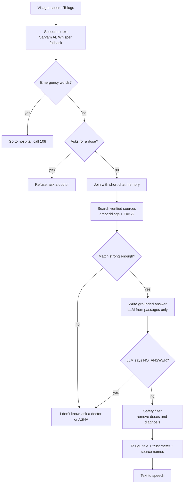

# Vaani (వాణి)

**A Telugu voice health-awareness assistant for people who cannot read or type.**
Tap one big button, ask a health question in Telugu, and hear a short answer that names its source.

> Vaani gives **general health awareness only**. It never diagnoses and never gives medicine doses.
> When it is not sure, it says: *"I don't know, please ask a doctor or ASHA worker."*

  

---

## 1. Why this project exists

Many people in rural Andhra Pradesh and Telangana (elderly people, daily-wage workers, women at home) cannot read or type.
Health apps need text. Phones can listen. Vaani is built for them:

- **No login, no typing, no reading.** One big round microphone.
- **Telugu in, Telugu out.** Speech to text, search, answer, text to speech.
- **Trust first.** Every answer shows its source and a trust meter. Weak match means "I don't know".
- **Emergency first.** Danger words skip everything and say: go to the hospital, call 108.

## 2. What it does today (V1)

| Area | Status |
|---|---|
| One big mic, picture-icon topic tiles (fever, pregnancy, baby, injury) | Done |
| Telugu speech to text (Sarvam AI, Whisper as backup) | Done |
| Grounded answers from verified PDFs (RAG) | Done |
| "I don't know" when sources do not answer | Done |
| Emergency fast lane + one-tap 108 / ASHA / PHC calls | Done |
| Listen again / slower playback | Done |
| Thumbs up/down feedback, unanswered-question log (SQLite) | Done |
| Night mode, installable web app (PWA), low-vision friendly sizes | Done |
| 45 automated tests | Done |

See the [Roadmap](#10-roadmap) for what is planned.

## 3. How it works



The code for each step:

| Step | File |
|---|---|
| Emergency / crisis fast lane, dose check | `src/safety.py` |
| Short memory of the current chat only | `src/conversation.py` |
| Search (multilingual embeddings + FAISS, TF-IDF fallback) | `src/retrieval.py` |
| Answer writing (extractive, or LLM) | `src/answer.py`, `src/llm.py` |
| Whole pipeline and trust meter | `src/pipeline.py` |
| Telugu speech to text | `src/asr.py` |
| Text to speech, English to Telugu translation | `src/tts.py`, `src/translate.py` |
| Database (unanswered questions, feedback) | `src/db.py` |
| Web API | `app/api.py` |
| Web app (PWA) | `app/static/` |

## 4. Safety rules (never broken)

1. General awareness only. **No diagnosis.**
2. **No medicine doses.** Dose requests are refused and sent to a doctor.
3. If the sources do not clearly answer, say **"I don't know"**.
4. Emergency words (chest pain, fits, heavy bleeding, snake bite and more) skip the normal flow: *go to hospital, call 108*.
5. Every answer **names its source**.
6. No photo-based diagnosis.
7. Chat memory lives only for the current chat.
8. **Privacy:** no login, no names, no voice recordings saved. Only unanswered questions and thumbs-down feedback are stored.

These rules are enforced in code and covered by tests (`tests/test_safety.py`, `tests/test_pipeline.py`).

## 5. Tech stack

- **Deep Learning:** multilingual-e5-small embeddings (Telugu question to English passage), Whisper (faster-whisper) ASR fallback, Sarvam AI speech and language models.
- **Data Science:** PDF cleaning and chunking, vector search with FAISS, threshold tuning with probe questions, evaluation set with hit-rate metrics, k-means topic clustering (planned for the ASHA dashboard).
- **Backend:** Python, FastAPI, SQLite.
- **Frontend:** plain HTML, CSS and JavaScript (installable PWA). No framework. Hind Guntur font, "Pasupu" turmeric design.
- **Voice:** Sarvam speech-to-text (`te-IN`), gTTS for speech out.

## 6. Run it on your laptop

You need Python 3.11+ and a free Sarvam AI key from https://dashboard.sarvam.ai.

```powershell
py -m venv venv
venv\Scripts\activate
pip install -r requirements.txt -r requirements-voice.txt
$env:SARVAM_API_KEY="your_key_here"
py -m uvicorn app.api:app --port 8001
```

Open http://127.0.0.1:8001 in Chrome and allow the microphone.

**Without a key** Vaani still works, but with weaker Telugu: Whisper for speech and extractive answers.
**Never put your key in a file or on GitHub.** Use the environment variable only.

### Build the knowledge base

1. Put the source PDFs in `data/sources/` (names are listed in `data/sources.csv`).
2. Run `py -m src.ingest` to cut them into chunks.
3. Try it in the terminal with `py -m src.cli`.

PDFs and generated chunks are not stored in this repository. Their links are in `data/sources.csv`.

## 7. Test and measure

```powershell
py -m unittest discover -s tests -t . -v     # 45 tests
py -m eval.run_eval                          # answer quality on data/test_questions.csv
py -m tools.probe                            # Telugu vs English match scores
```

Results are written to `eval/results.md` and `eval/log.csv` after each run.

**Known limits (honest list):**
- The test set is small (24 questions). It must grow to 100+.
- Search thresholds `(0.79, 0.82)` are provisional. Some off-topic Telugu questions score close to on-topic ones, so the LLM "NO_ANSWER" check is the second guard.
- Sarvam's Telugu answer quality is not yet measured on the full set.

## 8. API

| Route | What it does |
|---|---|
| `POST /ask` | Text question, returns answer, trust, sources |
| `POST /ask_voice` | Audio upload, returns transcript and answer |
| `POST /feedback` | Thumbs up/down on an answer |
| `GET /stats` | Counts only (no personal data) |
| `GET /admin/unanswered` | Unanswered questions. Needs header `X-Admin-Token` (set `VAANI_ADMIN_TOKEN`) |
| `GET /audio/{name}` | Spoken answer |
| `POST /end` | Clear the chat memory |
| `GET /health` | Server check |

Interactive docs: http://127.0.0.1:8001/docs

## 9. Project layout

```
app/            FastAPI server and the web app (app/static)
src/            The brain: safety, retrieval, answer, LLM, ASR, TTS, DB
data/           sources.csv (links to PDFs), test_questions.csv
eval/           Evaluation runner and results
tests/          45 automated tests
tools/          Small helper scripts (probe.py)
deploy/         Hugging Face Spaces files
Dockerfile      Container build
HANDOFF.md      Notes for the next work session
```

## 10. Roadmap

**Next (backend):** daily source watcher (WHO, MoHFW, NCDC), raw PDF archive with date and hash, cleaning and deduplication, topic labels with multilingual embeddings, DuckDB store, coverage dashboard.
**Star features:** "tell the doctor" summary, myth buster, speaker ID so one phone serves a whole family.
**ASHA dashboard:** weekly questions by topic, emergency count, clustering of questions, unanswered log.
**Quality:** nightly evaluation (hit rate, grounded rate, emergency recall, word error rate) sent to Telegram; 140+ question test set.
**Later:** medicine reminders (no dose advice), medicine strip reader, vaccine and pregnancy calendar, report reader (no interpretation), shake-to-call-108 with location to family, private mode, govt scheme guide (Aarogyasri, Ayushman Bharat), low-data mode, IVR / missed-call access.
**Deploy:** Hugging Face Spaces (`deploy/make_space.py`).

## 11. Sources and disclaimer

Answers come from public WHO and Government of India health guides listed in `data/sources.csv`.
Vaani is an awareness tool. It is **not** a doctor and does not replace one. In an emergency, call **108**.

## 12. Author

Sai Vaishnavi Katkam, B.Tech, KL University. Built as a placement and self-learning project (Deep Learning + Data Science).
GitHub: https://github.com/vaishnavikatkam41
